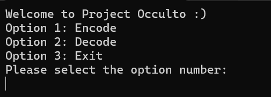
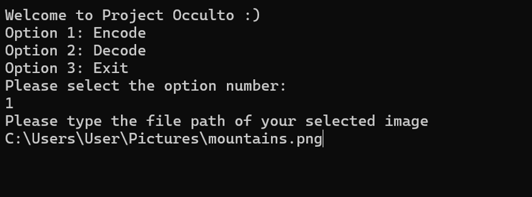
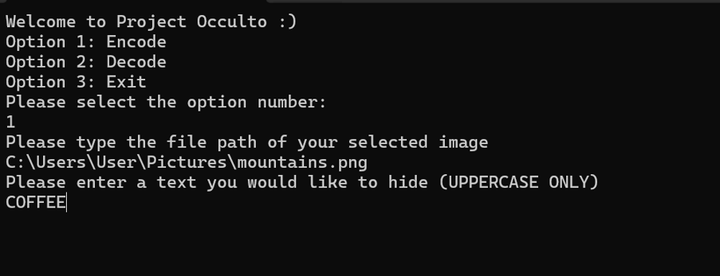
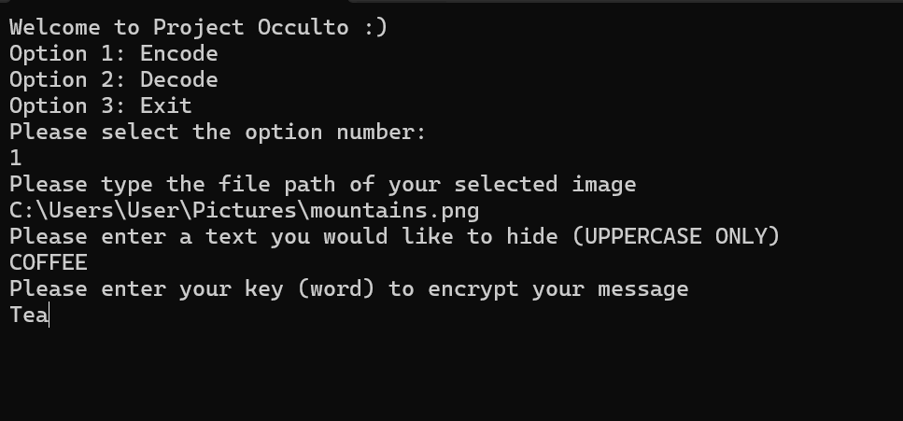
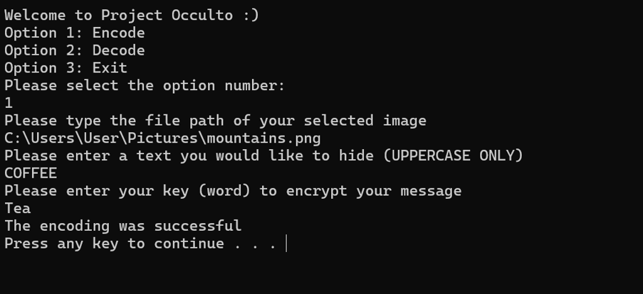
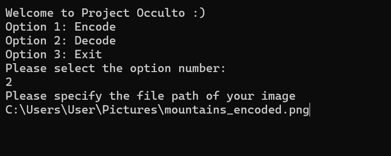
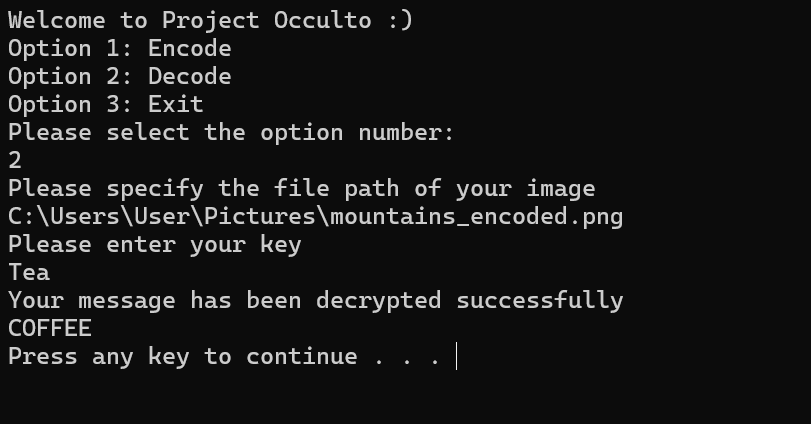
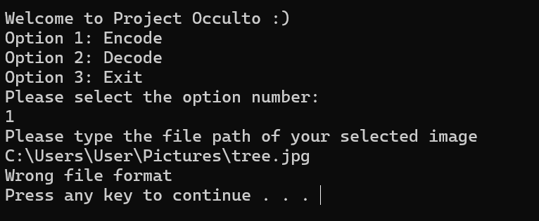
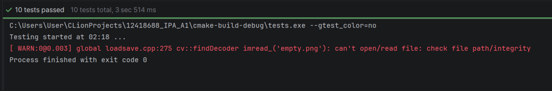

<<<<<<< HEAD
#Welcome to project Occulto by Michal Nowakowski

**Introduction:**
This program has been built to work on Windows Operating System.

Hello and welcome to program called Occulto which is a steganography tool that allows a user to hide any message inside
a picture. This program will hide any message of your choice within the picture of your choice, this message would be
encrypted, so even if anyone finds out that there is a message inside this picture, they still would not be able to
know what it is because of encryption method used to encrypt the message. This program uses a LSB (least significant bit) steganography
as well as Vigenere cipher encryption method to ensure the message is protected. Reminder, this program only supports PNG file format.

**Installation:**

2 Scenarios:

First Scenario (Running Occulto from pre-built executable file):

In this case all you need is:
the pre-built executable file (.exe file or just click on application file). Alternatively, the name of the application to run should be called 12418688_IPA_A1, find it and double click on it.
Installing the newest version of Visual C++ redistributable. You can use this link to download it https://aka.ms/vs/17/release/vc_redist.x64.exe
Also, make sure all DLL (Dynamic Link Libraries) files are inside the same folder as exe file.

Second Scenario (Building from Source):
Visual Studio/CLion IDE.
CMake to compile this program.
vcpkg as well as OpenCV

**How to use it:**

Once you finish all the steps from above, you can now run the program successfully. The first thing you should see as soon as the program runs, is a window on your screen with options 1,2 and 3, including the name of the project at the very top.

**Option 1: Encode**

This option lets a user hide message inside the image and choose a key word to encode it and decode it later, as long as the image selected is a **PNG** file.

As shown on the image below, when option 1 is being selected, right away the next question is to provide a _path_ to the picture you want to hide the message into. The path should look like the one provided on the screenshot below. Once you are happy with the selected image, just click enter to go to the next step.

The next question asked by the program to the user is to enter a message to hide, remember to use upper case letters ONLY. This message will not just be hidden but also encrypted, therefore even if somehow the image would be stolen or lost, the message will be unreadable, keeping it more secure and safer.

Once you chose a message to hide, now it is time to choose a key that will be used to decrypt your message later, and click enter.

After all of this, at the bottom of the menu, you should see the message that says  The encoding was successful , that is how you know that your message has been encoded correctly.

Once this is done, a new image should appear in the same folder you chose the image at the start of the program. In this case it was inside "Pictures" folder with a new name, in this instance it would be  mountains_encoded , this is how you know that the program worked and now the message you selected is now part of the image.

**Option 2: Decode**

As we discussed in the previous method how to encode your message, in this option we will look at how to decode it.

To do this, we need to open our program again and select number 2 from the menu, and copy the path of your encoded image into the program, just like you did in the previous step and click enter.

After that the program would ask you to provide your  key  word which you already provided when encoding message in the image.

Overview of the main functions:
Cipher.cpp
* Encrypt  - this function is meant to encrypt your message using Vinegere Cipher type of encryption. This way even if the image will be lost or intercepted by someone, your message will be unreadable.
* Decrypt  - decrypt the hidden text back to its original form.
  ImageHandler.cpp
* loadImage - loads selected image by the user, by specifying the path where to find it.
* validateImage - before loading the image, it checks whether the image is PNG file. If it is, then the program continues, however, if the image has any other extension, then the program will show the following message.

* saveImage -  once the encoding is successful, the new image will be added to the folder with new name.
* getImage -  it grabs the image, allowing to modify the image.
  Steganography.cpp
* encode -  it uses the LSB logic to encode the message into the image.
* decode - it extracts the message from the image. Uses the same logic (mathematical equation) to decode the message from the encoded image.

Test results:

CipherTest/EncryptDecrypt - PASSED
CipherTest/EncryptChangesMessage - PASSED
ImageHandlerTest/ValidPNG - PASSED
ImageHandlerTest/InvalidPNG - PASSED
ImageHandlerTest/LoadImage_InvalidFile - PASSED
ImageHandlerTest/LoadImage_ValidFile - PASSED
ImageHandlerTest/SaveImage - PASSED
ImageHandlerTest/get_Image - PASSED
SteganographyTest/Encode - PASSED
SteganographyTest/Decode - PASSED

**How I would make this project better if I did it again?**
I would make it so that after successfully encoding the message inside the image the program instead of closing, would run again automatically in a loop.
Also, for anyone wanting extra security, upon typing key word I would make characters all-stars instead of showing real message. This would ensure that even in the public setting, your key word would still be unknown, this would add extra protection layer to the program, making it even better and more resilient.
I would also make it so that when a user changes their mind and no longer wants to continue with the project, they can type exit at any stage of the program, and it would just exit at any moment.

=======
# OCCULTO
Not everything is as it seems. Conceal messages inside images with steganography and turn ordinary pictures into silent carriers of secrets.
>>>>>>> origin/main
